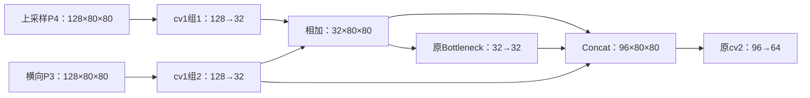

# YOLO11n：P3 来源分离投影与细节旁路实验记录

日期：2026-11-04。本轮已经修改代码并完成工程验证，尚未运行完整精度训练。以下区分实测事实、文献报告和待验证假设；不声明原创或指标提升。

## 第一阶段：实际仓库、环境和基线

- 主 checkout：`/root/home/2112406148/ultralytics`，`main`，提交 `55989f76c1e85c192ba12cb3e533e3de842a2301`，Ultralytics **8.4.198**。初检和结束前复检均有 1,041 个 tracked 修改；关键模型文件的 `git diff --ignore-space-at-eol` 为空，不能把行尾修改当成模型创新。本轮未修改主 checkout。
- 新 worktree：`/root/home/2112406148/ultralytics-visdrone-yolo11n-source-route`，分支 `exp/visdrone-yolo11n-source-route`，明确从上述原基准提交建立。已执行 `git fetch origin main`，但没有借机升级模型或训练框架。
- 已读取主仓库及旧 worktree 的 `AGENTS.md`、`docs/AGENTS.md`。沿用现有模块 owner；本轮没有新增 Python 模型类、注册名或第三方依赖。实验脚本和 YAML 单独保存，是为了复现和切换消融，不能放进模块前向代码。
- 实测解释器 `/home/miniconda3/envs/wql_env/bin/python`，Python **3.10.20**，PyTorch **2.5.1+cu121**，CUDA runtime **12.1**。宿主驱动 **535.216.03**，`nvidia-smi` 显示支持 CUDA **12.2**，这与 PyTorch runtime 是不同概念。GPU 0/1 均为 **RTX 3090 24 GiB**，有其他任务占用，未终止它们。
- 验证脚本将 worktree 放在 `sys.path[0]`，实际导入路径已写入 `verification_*.json`，不依赖环境中另一份已安装的 Ultralytics。`utils/dist.py` 的 DDP 临时文件保存当前 `sys.path`，双卡检查也使用本 worktree。

### 基于逐层 hook 的结构表

输入为 `1×3×640×640`，类别数为 10。以下表格由本轮真实前向的 `artifacts/source_route/baseline_shapes.json` 生成；Detect 的原始返回类型为字典，不能按旧版假定为三个预测张量。

| 层 | 模块 | 来源 | 输入 B×C×H×W | 输出 B×C×H×W | stride |
|---:|---|---|---|---|---|
| 0 | Conv | -1 | 1×3×640×640 | 1×16×320×320 | 2 |
| 1 | Conv | -1 | 1×16×320×320 | 1×32×160×160 | 4 |
| 2 | C3k2 | -1 | 1×32×160×160 | 1×64×160×160 | 4 |
| 3 | Conv | -1 | 1×64×160×160 | 1×64×80×80 | 8 |
| 4 | C3k2 | -1 | 1×64×80×80 | 1×128×80×80 | 8 |
| 5 | Conv | -1 | 1×128×80×80 | 1×128×40×40 | 16 |
| 6 | C3k2 | -1 | 1×128×40×40 | 1×128×40×40 | 16 |
| 7 | Conv | -1 | 1×128×40×40 | 1×256×20×20 | 32 |
| 8 | C3k2 | -1 | 1×256×20×20 | 1×256×20×20 | 32 |
| 9 | SPPF | -1 | 1×256×20×20 | 1×256×20×20 | 32 |
| 10 | C2PSA | -1 | 1×256×20×20 | 1×256×20×20 | 32 |
| 11 | Upsample | -1 | 1×256×20×20 | 1×256×40×40 | 16 |
| 12 | Concat | [-1, 6] | 1×256×40×40; 1×128×40×40 | 1×384×40×40 | 16 |
| 13 | C3k2 | -1 | 1×384×40×40 | 1×128×40×40 | 16 |
| 14 | Upsample | -1 | 1×128×40×40 | 1×128×80×80 | 8 |
| 15 | Concat | [-1, 4] | 1×128×80×80; 1×128×80×80 | 1×256×80×80 | 8 |
| 16 | C3k2 | -1 | 1×256×80×80 | 1×64×80×80 | 8 |
| 17 | Conv | -1 | 1×64×80×80 | 1×64×40×40 | 16 |
| 18 | Concat | [-1, 13] | 1×64×40×40; 1×128×40×40 | 1×192×40×40 | 16 |
| 19 | C3k2 | -1 | 1×192×40×40 | 1×128×40×40 | 16 |
| 20 | Conv | -1 | 1×128×40×40 | 1×128×20×20 | 32 |
| 21 | Concat | [-1, 10] | 1×128×20×20; 1×256×20×20 | 1×384×20×20 | 32 |
| 22 | C3k2 | -1 | 1×384×20×20 | 1×256×20×20 | 32 |
| 23 | Detect | [16, 19, 22] | 1×64×80×80; 1×128×40×40; 1×256×20×20 | decoded 1×14×8400；boxes 1×64×8400；scores 1×10×8400 | 8/16/32 |

层 0–10 为 Backbone，层 11–22 为 Neck，层 23 为 Detect；源码 YAML 将 Neck 和 Detect 统称 `head`。新模型保持这些层号、来源索引和输出形状。

原始 `ultralytics/cfg/models/11/yolo11.yaml` 的 `nc=80`。本轮三个实验 YAML 均显式固定 `nc=10, scale=n`；它们之间只在第 **16** 层的 `C3k2` 参数上有差别。检测仍为 P3/P4/P5，没有 P2。

### 参数与计算统计口径

单独构建 10 类 YAML 的基准为 **2,591,790 参数**；加载原始 checkpoint 后，当前 `BaseModel.load()` 会恢复其分类塔隐藏宽度，因此实训迁移口径的基准为 **2,607,070 参数**。不能拿两种口径混比。

环境中的 THOP `profile()` 支持直接调用，但不接受仓库 `get_flops()` 传入的 `stride/min_cells`，后者捕获异常并返回 **0.0**。这不是零计算量。本轮统一使用 PyTorch profiler 的 `with_flops=True`，FP32、640、batch=1、含解码，记录支持的 Conv/MatMul/逐元素算子 FLOPs；不能等同于完整硬件操作数或其他论文的 THOP 数值。

### 数据配置与实测分布

新 worktree 的 `VisDrone.yaml` 复制了主项目现有转换逻辑，唯一运行路径变化是固定为 `/root/home/2112406148/datasets/VisDrone`。类别依次为 pedestrian、people、bicycle、car、van、truck、tricycle、awning-tricycle、bus、motor。

| 划分 | 图片 | 标签文件 | 转换后标签行数（去重前） | 单图最多框 | 缩放至640后短边<8像素 | 缩放至640后面积<32² |
|---|---:|---:|---:|---:|---:|---:|
| train | 6471 | 6471 | 343204 | 902 | 46.13% | 90.55% |
| val | 548 | 548 | 38759 | 317 | 45.18% | 92.44% |
| test-dev | 1610 | 1610 | 75102 | 461 | 52.40% | 93.19% |

这里的缩放统计采用 `r=640/max(W,H)`、无随机增强；**不是 COCO 原图面积 APsmall 定义**。对原始 val ZIP 复核得到 38,759 个有效框、1,410 个被过滤记录，其中 21,949 个有效框标记有遮挡，约 **56.63%**。它证明数据具有小目标、密集和遮挡特征，尚不证明模型的具体错误归因。

转换过滤 `score=0`、类别不在 1–10、非正宽高；类别减 1，将 xywh 归一化并写入已有的 images/labels 划分。本轮没有重转换数据或更改划分。已核对已有dataloader缓存：训练集仍为6471张，4条重复标签被加载器移除，实际343200框；验证集548张、38759框与标签统计一致，0损坏图片。缓存消息与计数见 `dataloader_cache_audit.json`。各划分标签内容及文件名的 SHA256 见 `data_audit.json`，训练入口也将其写入 manifest。转换后的 YOLO 标签删除了 ignored regions，并不自动等同于 VisDrone 官方挑战赛的完整忽略区域评测。

**阶段结果：** 仓库/环境/尺寸/参数/数据均已实际核查。未确认的是按面积、密度、遮挡分桶的模型错误分布。下一步是用单一 P3 改动检验该假设；当前无需用户决定工程选项。

## 第二阶段：文献检索与真实性边界

本轮重新查询 Crossref，读取 CVF 官方 QueryDet 页面、PDF、官方代码 README 和 VisDrone 配置；通过 Europe PMC 读取与 DOI 对应的 YOLO-MARS、RFAG-YOLO 全文，绕过 MDPI 网页的 403。原始元数据和可访问全文保存在 `artifacts/source_route/literature/`；部分下载文本仅规整行尾空白以通过Git检查，未改写研究内容。检索中出现的同行评审附件不是研究论文，已排除；BRA-YOLOv10 摘要使用 SIDD/TIB-Net/Det-Fly/UAVfly，也不冒称为 VisDrone 论文。

表中指标为论文报告的百分比。`未查证`表示没有足够证据，不代表 0。没有查到代码不能写成“未公开”。

| 论文 | 年份 | 渠道 | 基线 | 模型规模 | 改进模块 | 数据集划分 | 输入尺寸 | mAP50 | mAP50:95 | APsmall | Params | FLOPs | FPS | 训练设置 | 代码 |
|---|---:|---|---|---|---|---|---|---:|---:|---|---|---|---|---|---|
| QueryDet: Cascaded Sparse Query for Accelerating High-Resolution Small Object Detection | 2022 | CVPR，正式发表 | RetinaNet | ResNet-50 | P2、高分辨率稀疏查询 CSQ | **VisDrone val，表2**；训练原图分4块 | 论文具体尺寸未查证；公开代码 train short=1200/max=1999，test length=3999 | **48.14** | **28.32** | VisDrone 未查证；不能挪用 COCO APS | 未查证 | 未查证 | **2.75，2080Ti**；计时边界需按原文复现 | 50k iterations，LR=.01，在30k/40k衰减；8×2080Ti；公开代码 batch=8、ImageNet R50 预训练 | **已核验官方仓库** |
| YOLO-MARS: An Enhanced YOLOv8n for Small Object Detection in UAV Aerial Imagery | 2025 | Sensors，正式发表 | YOLOv8n | n 变体 | ERAC、PD-ASPP、SGCS-FPN、WIoUv3 | VisDrone；**消融明确为val，表3**；训练6471/val548；文章另称test3190 | **640×640** | **40.9** | **23.4** | 未查证 | **2.93M** | 未查证 | 未查证 | **200 epoch，batch16，LR=.01，momentum=.937，WD=.0005，RTX3090**；预训练未查证 | 全文未发现作者实现链接，未查证 |
| RFAG-YOLO: A Receptive Field Attention-Guided YOLO Network for Small-Object Detection in UAV Images | 2025 | Sensors，正式发表 | YOLOv8 | 文中另与 v8n/v8s 比较，不能视作 n 等规模替换 | RFN、改进 FasterNet、SAF 尺度注意融合 | **6471/548/1610，表3明确val** | **640×640** | **38.9** | **23.1** | 未查证 | **5.94M** | **15.7G** | **82.0，RTX2060**；预处理/NMS/精度口径未查证 | **300 epoch，batch8，SGD，LR=.01，从头训练，RTX2060** | 作者实现链接未查证 |
| GLDS-YOLO: An Improved Lightweight Model for Small Object Detection in UAV Aerial Imagery | 2025 | Electronics，正式发表元数据已核验 | YOLO11n | n 变体 | GSA、LSKA、DCNv4、SMSDE（摘要） | VisDrone2019/DOTA1.0；val/test未查证 | 未查证 | 未查证 | 未查证 | 未查证 | 未查证 | 未查证 | 未查证 | 未查证 | 未查证 |
| SPTD-YOLO: Small-Object-Aware Pyramidal and Task-Aligned Dynamic YOLO for UAV Small Object Detection | 2026 | Applied Sciences，正式发表元数据已核验 | YOLOv12 | 未查证 | SOEP/SPDConv/CSPOmniKernel、P2、TADDH（摘要） | VisDrone2019；划分未查证 | 未查证 | 未查证 | 未查证 | 未查证 | 未查证 | 未查证 | 未查证 | 未查证 | 未查证 |
| A Lightweight Fusion Strategy With Enhanced Interlayer Feature Correlation for Small Object Detection | 2024 | IEEE TGRS，正式发表元数据已核验 | 未查证 | 未查证 | 具体结构未取得全文，不依据题名推测 | VisDrone使用与划分未查证 | 未查证 | 未查证 | 未查证 | 未查证 | 未查证 | 未查证 | 未查证 | 未查证 | 未查证 |
| AED-YOLO11: A small object detection model based on YOLO11 | 2025 | Digital Signal Processing，正式发表元数据已核验 | YOLO11 | 未查证 | 未查证 | VisDrone使用与划分未查证 | 未查证 | 未查证 | 未查证 | 未查证 | 未查证 | 未查证 | 未查证 | 未查证 | 未查证 |
| LSF-YOLOv11: A Lightweight Feature Fusion Method for Small Object Detection on VisDrone | 2026 | ISCAIT，正式会议元数据已核验 | YOLOv11 | 未查证 | 具体融合机制未查证 | 题名含VisDrone；具体版本与划分未查证 | 未查证 | 未查证 | 未查证 | 未查证 | 未查证 | 未查证 | 未查证 | 未查证 | 未查证 |

补充：RFAG 全文表6报告其 YOLOv10n 对照为 mAP50=36.7%、mAP50:95=19.6%、2.3M、6.7G；这是**该论文的对照结果**，不冒称为 YOLOv10 作者的官方 VisDrone 结果。RFAG 表3的 Precision/Recall 为49.6%/37.8%；MARS 表3完整模型为50.2%/40.0%。两文使用不同训练时长、batch、初始化和硬件，不能据此排名本地 YOLO11n。

QueryDet 公开配置与论文数字不是已证明完全相同的运行快照：公开 test 配置默认为 `QUERY_INFER=False`，README 要求另传 True 才启用 CSQ；阈值公开配置 .12，而论文为 .15。本表数字取**论文表2的 CSQ=True**，没有把代码默认值当成论文设置。官方代码 YAML 含 Python tag，本轮只按文本读取，未执行或 unsafe-load。

GLDS/SPTD 摘要报告的是相对基线的增量，无法确认百分点/相对比例及运行口径，因此没有填入绝对 mAP 栏。MARS 表4中的一些其他模型数值存在可疑之处，本轮只引用其表3的自身消融结果，不替论文修正或推算。

### 可点击出处、作者和 DOI

- **YOLO-MARS: An Enhanced YOLOv8n for Small Object Detection in UAV Aerial Imagery**；Guofeng Zhang、Yanfei Peng、Jincheng Li；2025；Sensors；正式发表元数据已核验。DOI：[ 10.3390/s25082534 ](https://doi.org/10.3390/s25082534)；[出版方记录/全文](https://www.mdpi.com/1424-8220/25/8/2534)。
- **A Lightweight Fusion Strategy With Enhanced Interlayer Feature Correlation for Small Object Detection**；Yao Xiao、Tingfa Xu、Xin Yu、Yuqiang Fang、Jianan Li；2024；IEEE Transactions on Geoscience and Remote Sensing；正式发表元数据已核验。DOI：[ 10.1109/tgrs.2024.3457155 ](https://doi.org/10.1109/tgrs.2024.3457155)；[出版方记录/全文](https://ieeexplore.ieee.org/document/10671587/)。
- **AED-YOLO11: A small object detection model based on YOLO11**；Xuejian Gong、Jiong Yu、Huayi Zhang、Xinsheng Dong；2025；Digital Signal Processing；正式发表元数据已核验。DOI：[ 10.1016/j.dsp.2025.105411 ](https://doi.org/10.1016/j.dsp.2025.105411)；[出版方记录/全文](https://linkinghub.elsevier.com/retrieve/pii/S1051200425004336)。
- **RFAG-YOLO: A Receptive Field Attention-Guided YOLO Network for Small-Object Detection in UAV Images**；Chengmeng Wei、Wenhong Wang；2025；Sensors；正式发表元数据已核验。DOI：[ 10.3390/s25072193 ](https://doi.org/10.3390/s25072193)；[出版方记录/全文](https://www.mdpi.com/1424-8220/25/7/2193)。
- **GLDS-YOLO: An Improved Lightweight Model for Small Object Detection in UAV Aerial Imagery**；Zhiyong Ju、Jiacheng Shui、Jiameng Huang；2025；Electronics；正式发表元数据已核验。DOI：[ 10.3390/electronics14193831 ](https://doi.org/10.3390/electronics14193831)；[出版方记录/全文](https://www.mdpi.com/2079-9292/14/19/3831)。
- **SPTD-YOLO: Small-Object-Aware Pyramidal and Task-Aligned Dynamic YOLO for UAV Small Object Detection**；Jiarui Liang、Jiachen Yu、Mingyang Li、Yikui Zhai、Xiaolin Tian；2026；Applied Sciences；正式发表元数据已核验。DOI：[ 10.3390/app16126062 ](https://doi.org/10.3390/app16126062)；[出版方记录/全文](https://www.mdpi.com/2076-3417/16/12/6062)。
- **BRA-YOLOv10: UAV Small Target Detection Based on YOLOv10**；Quanyu Zhang、Xin Wang、Heng Shi、Kunhui Wang、Yan Tian、Zhaohui Xu、Yongkang Zhang、Gaoxiang Jia；2025；Drones；正式发表元数据已核验。DOI：[ 10.3390/drones9030159 ](https://doi.org/10.3390/drones9030159)；[出版方记录/全文](https://www.mdpi.com/2504-446X/9/3/159)。
- **QueryDet: Cascaded Sparse Query for Accelerating High-Resolution Small Object Detection**；Chenhongyi Yang、Zehao Huang、Naiyan Wang；2022；2022 IEEE/CVF Conference on Computer Vision and Pattern Recognition (CVPR)；正式发表元数据已核验。DOI：[ 10.1109/cvpr52688.2022.01330 ](https://doi.org/10.1109/cvpr52688.2022.01330)；[出版方记录/全文](https://openaccess.thecvf.com/content/CVPR2022/html/Yang_QueryDet_Cascaded_Sparse_Query_for_Accelerating_High-Resolution_Small_Object_Detection_CVPR_2022_paper.html)。
- **LSF-YOLOv11: A Lightweight Feature Fusion Method for Small Object Detection on VisDrone**；Buyun Wang；2026；2026 5th International Symposium on Computer Applications and Information Technology (ISCAIT)；正式发表元数据已核验。DOI：[ 10.1109/iscait69154.2026.11477258 ](https://doi.org/10.1109/iscait69154.2026.11477258)；[出版方记录/全文](http://xplorestaging.ieee.org/ielx8/11477131/11477178/11477258.pdf?arnumber=11477258)。
- **Application of YOLOv11N with HWD Downsampling and Shallow Feature Enhancement in Small Object Detection on Visdrone Dataset**；Jian Sun、Yizheng Xu；2026；2026 IEEE 3rd International Conference on Computer Vision and Deep Learning (DLCV)；正式发表元数据已核验。DOI：[ 10.1109/dlcv69906.2026.11635709 ](https://doi.org/10.1109/dlcv69906.2026.11635709)；[出版方记录/全文](http://xplorestaging.ieee.org/ielx8/11635063/11635100/11635709.pdf?arnumber=11635709)。
- **PSF-YOLO11: An enhanced YOLO11 Framework for Small Object Detection in UAV Imagery**；Dan Shan、Xiangdong Meng、Carlos Ferran、Xuan Tong、Xifeng Guo；2026；渠道未查证；预印本/posted-content，不能视为正式发表。DOI：[ 10.2139/ssrn.7106441 ](https://doi.org/10.2139/ssrn.7106441)；[出版方记录/全文](https://doi.org/10.2139/ssrn.7106441)。

已核验公开代码：[QueryDet-PyTorch](https://github.com/ChenhongyiYang/QueryDet-PyTorch)，作者在 CVF 官方页面直接提供该链接；README 包含 VisDrone 的训练、推理和环境配置。本轮没有复制其代码或引入其 Spconv/Detectron2 依赖。

**阶段结果：** 8 项直接/潜在相关研究与 1 项 YOLOv10 对照证据已整理；三篇取得全文。可排除“单加浅层支路/通用注意就是创新”的说法，但不能排除所有同构先例，尤其 TGRS/LSF 全文仍待核对。下一步按可解释路径做工程假设，不能写“首次提出”；无需等待全文才能完成已授权的局部实现。

## 第三阶段：瓶颈定位与可证伪假设

以下“误差机制”仍是待验证假设，不把数据分布或源码结构直接当作因果证明。

| 源码位置 | 张量与实际数据证据 | 可能误差 | 文献证据及其边界 | 可验证假设 |
|---|---|---|---|---|
| `Conv` 层1、3、5，`yolo11.yaml` | stride4的160²→stride8的80²→stride16的40²；val45.18%框在640下短边<8 | 小目标可用采样点过少；纹理经下采样丢失 | QueryDet全文说明高分辨率细节的重要性，但没有证明本模型某个Conv已丢失哪些目标 | 按640缩放后短边<8、8–16、≥16分桶召回，结合原图面积APsmall |
| `block.py:C2f/C3k2`，Backbone层4 | 64→128通道、80²；hidden=32，原投影两支各32 | 窄通道和背景竞争可能压低小目标响应 | RFAG的局部细节/背景问题支持动机，不证明当前C3k2瓶颈必然有害 | 对目标/背景区域激活及梯度对比；Backbone-only候选与Neck-only分开 |
| `block.py:SPPF`，层9 | 256×20²；隐藏128；串行5×5池化 | 强背景响应可能扩散，但也能提供有效上下文 | MARS改变上下文结构不能证明简单直连有效；已有两次SPPF实验未显示稳定增益 | 查看旧增益是否学习、按目标尺度评估；本轮恢复原始SPPF |
| `block.py:C2PSA/Attention`，层10 | 256×20²；注意分支128×20²，400位置 | 粗尺度全局语义不能重建已经丢失的浅层采样；是否成本过高需实测 | GLDS/注意力相关摘要只能支持存在研究方向，不能当作C2PSA有害证据 | 单独profile后再决定消融，禁止凭名称删除全局注意 |
| `Conv/Concat/C3k2`，层12/15/18/21 | Concat分别384/256/192/384通道；P3的两路均128×80² | 统一投影后再分流，两个分支都可能受上采样语义或背景污染；可能冗余 | MARS的SGCS-FPN、RFAG的SAF证实该问题已有多种研究；不代表本方案已有效 | 只改层16；测“改变U时细节旁路不变”，并用separate控制组判断交互项 |
| Neck层13→16→19→22 | P4/P3/P4/P5在128/64/128/256通道间融合 | 上采样语义与横向定位特征可能不匹配 | TGRS题名相关，具体机制未查证，不能拿它作已证实因果 | 记录拼接前来源范数/相关性；检查P3目标与背景区域信息保留 |
| `head.py:Detect` 层23，`cv2/cv3` | 输入64×80²、128×40²、256×20²；分类与回归**已经分塔** | Neck共享表征仍可能有任务梯度冲突；不能说YOLO11原头未解耦 | SPTD摘要涉及分类定位对齐，细节未查证 | 分解分类混淆与定位IoU错误；Head-only实验单独做 |
| Detect采样与后处理 | 640下8400候选点；val最多317 GT，遮挡框56.63% | 相邻目标表征相似、漏检或NMS误抑制；需区分网络与后处理问题 | QueryDet/MARS/RFAG支持小而密集的场景困难，未证明本地NMS是主因 | 固定conf/IoU/max_det，分密度/遮挡评估召回；NMS前后单独计数 |

坐标采用连续回归，不能把 stride8 误写成“边界框只能按8像素量化”。本轮只改变 P3 融合，不会恢复 P2 已经丢失的空间信息，也没有修改 NMS 或保证解决遮挡。

### 从旧 SPPF 分支吸取的经验

已读提交 `8e8aef0b1b2239f0ee59aa37f47f4bafc7ccae56`、实现和两份 `best.pt`。旧式为 `F(X)+α⊙X`，位于 P5，256个零初始化增益。两个 checkpoint 的 α 平均绝对值分别约 **0.09339、0.08357**，说明增益有学习，不能把无收益简单解释为“门控完全没训练”。但是增加幅度通路没有直接解决 P3 来源混合或极小目标采样问题。

历史基准最高val mAP50:95=18.883%，SPPF batch20/120轮为18.905%，batch30/100轮为18.569%。它们不是匹配训练时长、batch、加载流程的最终统计对照，不据此证明SPPF永远无效。本轮不再对SPPF增加增益，也不叠加原分支。

**阶段结果：** 已验证数据小目标/遮挡比例和源码融合位置，误检/漏检的因果归因仍未确认。优先检验 P3 来源独立性，下一步只引入这个机制。

## 第四阶段：三套候选及选择依据

### A：P3 C3k2 来源分离投影与细节旁路（本轮实现）

**问题与 owner：** 第16层已有C3k2在两路来源已经混合后才分流。将“保护一个来源投影后的细节分支”和“对上下文/细节进行瓶颈交互”分开，不新建模块、层级或注意力。

记 `U,L∈R^(B×128×80×80)` 分别为上采样语义和横向P3，`c=32`，`φ`为Conv-BN-SiLU，`M`为原有Bottleneck，`O`为原cv2。

原结构：

```text
(a,b)=split(φ_W([U,L]))          # W:256→64
z=M(b)
Y=O([a,b,z])                    # 96→64
```

原Bottleneck的内部扩展率为0.5，即32→16→32；本轮不改变它。

新结构：

```text
u=φ_Wu(U), l=φ_Wl(L)            # 各128→32，合用一个groups=2的cv1
s=u+l
z=M(s)
Y=O([l,s,z])                    # 输入仍96、输出仍64
```

数学式为 `Y=φ_O(concat(l,s,M(s)))`，`s=φ_Wu(U)+φ_Wl(L)`。细节保护仅指**最后投影之前的32通道旁路**，不是128通道原始特征的无损传递。BN和SiLU在来源混合前分别作用，因此也不能把这写成仅对一个线性矩阵改名。



**与已有方法差异/归类：** 分组卷积、CSP旁路和加法融合均是已有思想。与MARS的多级浅层引导、RFAG的动态尺度权重、QueryDet的高分辨率稀疏Head不同，此处只在现有P3 C3k2内部改变投影约束、旁路来源和交互顺序；没有新金字塔节点或预测头。相较旧SPPF不是再加一个可学习残差幅度。属于**针对性连接重构/工程研究假设**，不是已证明的新范式；TGRS/LSF等全文未核对，不能声明首创。

**理论参数和计算：** 原cv1权重为 `2c(Cu+Cl)=64×256=16384`；分组后为 `cCu+cCl=32×128×2=8192`，BN参数不变，故总参数 **减少8192**。在80²上卷积MAC减少52,428,800，以每MAC两FLOPs计减少0.1048576G；新增s的相加为204,800次，净减少约 **0.1046528G**。显存中仍有Concat及s，不能据参数减少推断大幅省显存。

**收益/副作用/延迟：** 可能减轻来源过早混合，并为密集目标保留独立的横向投影；也可能损失跨来源表达、增大s的幅度或引入预训练BN分布偏移。最终64通道仍可能压缩小目标。分组Conv的GPU效率不一定好，必须测真实延迟，本轮结果见第五阶段。

**最小消融/适配：** baseline→separate→detail；separate保留来源投影和细节旁路，但让瓶颈只接u，即 `O([l,u,M(u)])`。detail与separate参数相同，主要区别是瓶颈输入是否加入l。只能对两路等宽的P3启用；P4的256+128不能错误地一分为二。当前YOLO11n、原解析器可直接实现。

### B：浅层 C3k2 变换通道预算重分配（候选，未实现）

**问题/位置：** Backbone第4层，输入64×80²、输出128×80²，hidden=32。原 `a,b=split(cv1(X)); z=M32(b); Y=cv2([a,b,z])` 对b的全部通道做两次3×3。

**新数据流/公式：** 将 `b=[b0,b1]`，各16通道；用原Bottleneck结构的16通道版本处理b0，`z=[M16(b0),b1]`，继续原cv2，输出不变。若深度>1可轮换处理的半通道；但YOLO11n此层深度缩放后只有1块，不能虚构“多轮交换”的收益。

**区别/归类：** 与已存在的部分通道计算思想相似，RFAG全文也采用FasterNet体系；它只是把通道预算约束放进已有C3k2的瓶颈，保留来源/层级拓扑，属于已有轻量思想的局部适配，创新强度较弱。不能把它换名宣称原创。

**成本/延迟/收益：** 当前C3k2内Bottleneck扩展率实际为0.5，两个3×3的卷积参数从 `9c²` 到 `9(c/2)²`，c=32时少6,912权重，另少48个BN仿射参数；瓶颈卷积FLOPs约少0.0884736G，未含BN/拼接变化。可能保留未变换细节、减少计算；也可能削弱局部建模、增加分割拼接开销，实际延迟未测。

**最小消融/适配：** 仅Backbone层4启用，其他层保持基准；比较APsmall/定位误差和实际延迟，不与A一起首次训练。能在现有C3k2 owner实现，但会改变瓶颈权重形状，需要明确预训练裁剪策略。当前未编码，适合做后续Backbone-only候选。

### C：P3 定位分支的低秩卷积分解（候选，未实现）

**问题/位置：** Detect第23层P3回归塔的第一个3×3，实际64→64、80²；分类塔本来已独立，不能称为新“解耦头”。

**原/新结构和公式：** 原 `b=φ(W3×3*X)`；候选 `b=φ(W1×3*φ(W3×1*X))`，中间rank=32、空间仍80²、最终64通道，后续原回归塔和分类塔保持。分别为64→32→64。

**区别/归类：** 低秩/可分离卷积本身是已有方法；与SPTD的动态任务对齐双门控不同，这里没有动态核、门控或改变损失，只有现有回归卷积的预算控制。它是**工程对照**，不能作为单独创新宣称，故排在后面。

**成本/延迟/收益：** 卷积权重36,864→12,288，少24,576；多一层中间BN时净参数约少24,512，卷积FLOPs约少0.3145728G，未含额外BN/激活。可能降低定位塔开销并带来正则化，但有限rank可能损害遮挡边缘表达，两次kernel启动也可能更慢。未测精度或延迟。

**最小消融/适配：** 只改Head的P3回归第一层，分类和其他尺度不变；从相同checkpoint处理分解初始化，并报告近似误差或同种子从头对照。可以在已有head.py owner内实现，无须新模块名。当前未编码。

### 排序

| 候选 | 与已知方法差异 | VisDrone针对性 | n模型成本 | 实现复杂度 | 消融解释性 | 硕士工作量 | 决策 |
|---|---|---|---|---|---|---|---|
| A | 限定在来源/旁路/交互顺序；原创性仍待全文核查 | 直接针对P3细节与融合 | 参数/FLOPs略降，延迟待测 | 低，现有owner | 有同参数separate控制 | 可做诊断与三种子验证 | 本轮实施 |
| B | 与部分通道计算重叠较大 | 浅层细节/计算预算 | 理论减少，但表征损失风险 | 中，需权重裁剪 | Backbone单点可解释 | 可作第二个独立变量 | 后续候选 |
| C | 已有低秩思想，创新性最低 | 定位预算相关，间接作用于小目标 | FLOPs下降不保证快 | 中，初始化需控制 | Head单点明确 | 适合作工程负对照 | 后续候选 |

**阶段结果：** 已比较三种路径，选A并明确相似性、成本与风险。没有用多个模块堆叠回避归因问题；下一步验证A的工程可运行性。

## 第五阶段：已实现内容与实际验证

### 修改文件及消融开关

1. `ultralytics/nn/modules/block.py`：只扩展既有 **C3k2**，新尾参数 `source_route=None/"separate"/"detail"`；默认None保留原C2f路径，旧pickled模型无此属性也走原路径。新增代码注释标记 `[VisDrone source-route ablation]`。
2. `ultralytics/nn/tasks.py:BaseModel.load`：只为opt-in分组投影迁移原cv1权重的两个对角块；原 `[64,256,1,1]`→`[64,128,1,1]`。BN键不变，变体checkpoint已经分组时不再裁剪。**不是随机丢弃整个P3投影**；但裁剪不保持原模型数值等价，BN统计也可能需要在训练中适应。
3. 三个模型YAML：`yolo11n-visdrone-baseline.yaml`、`yolo11n-visdrone-source-separate.yaml`、`yolo11n-visdrone-source-route.yaml`。唯一机制改动位于layer16。原始通用 `yolo11.yaml` 未改。
4. `VisDrone.yaml`：沿用已有转换逻辑并固定实际绝对数据路径。没有更改标签或划分。
5. `scripts/visdrone_source_route.py` 与 `scripts/visdrone_source_route_train.yaml`：本地包导入、三组相同训练配方、预训练/标签/source哈希manifest、验证、双卡检查、交错计时和可选APsmall评估入口。

`C3k2`原已导出到modules并在tasks.py导入，且处于 `base_modules/repeat_modules`。新参数追加在末尾，解析器仍按原方式插入c1/c2/n；**没有新增注册名或解析特判**。显式来源开关的YAML参数为 `[256, False, 0.5, False, 1, True, "detail"]`。

### 已通过的检查

- 三组YAML都能构建，差异检查严格只有第16层；640输入输出均 `(1,14,8400)`，384×640、672×672输入也通过。
- 默认C3k2与原C2f路径逐值一致；`forward_split`一致；细节旁路对U扰动逐值不变，交互支路有响应。
- 原80类预训练加载后，分组权重逐值等于原cv1的对角块；变体到变体重载逐值一致。旧SPPF没有被带入。
- 对两张真实train图片采用640等比例letterbox，真实box/cls/DFL loss及全模型反传为有限值，分组两半均有梯度，优化器一步确实改变权重。这不是完整训练结果。
- 实际 `DetectionTrainer.setup_model()` 三组均通过，类别名一致，均从原checkpoint按名称映射4/10类输出；日志为499/499项迁移（含分类重映射项），参数口径与统计一致。训练入口明确把**原80类checkpoint路径**交给trainer，避免先载入中间10类模型而改变初始化流程。
- 两张RTX3090、每rank两张真实图片的NCCL DDP：前向、反传、梯度all-gather一致、优化器更新通过。
- Conv-BN融合前后输出在容差内一致；**Ultralytics原生TorchScript导出、保存、重新加载、推理一致性通过**。发现并修复导出器将forward绑定到forward_split后的递归问题。未测试ONNX/TensorRT，环境缺少相关可选包。
- `compileall`、`git diff --check`通过。环境没有Ruff，没有安装新依赖来运行它。

### 实测开销

| 模型 | 实训迁移参数 | Profiler GFLOPs | GPU前向峰值MiB | 融合交错计时中位数ms |
|---|---:|---:|---:|---:|
| baseline | 2,607,070 | 6.449898 | 72.019 | 8.004 |
| separate | 2,598,878 | 6.345040 | 71.988 | 8.024 |
| detail | 2,598,878 | 6.345245 | 71.988 | 8.042 |

两rank的DDP检查使用不同的真实图像增强（rank1水平翻转并同步变换框坐标），避免相同输入让梯度同步检查失去区分力。

GPU条件：RTX3090，FP32、batch=1、640，前向含解码，不含预处理/NMS。最后一列来自**Conv-BN已融合**的6轮交错计时，每轮50次、预热20次、轮换三组执行次序。显存列来自未融合模型的独立前向分配峰值，不是训练总显存。

先前顺序测量的未融合结果为12.24/15.50/15.09ms，保留于 `verification_cuda.json`；与融合交错计时不混用。不能把算子融合或共享GPU负载变化算成结构加速。融合主模型相对基准的差值很小且略慢，**没有实证速度提升**。当前GPU有其他任务，数值只用于开销排查，正式FPS需要在相同负载条件重测并报告原始样本。

主模型batch2反传检查时进程CUDA峰值约 **508.90 MiB**，不含其他进程，不可线性外推batch20/30的完整训练显存。输出的box/cls/DFL损失只证明工程路径有效，不是模型已经收敛。

**阶段结果：** 工程验证全部完成，模型可用于后续双卡训练；AP、正式速度和训练显存仍不能宣称收益。下一步是同配方三组对照，不再在完整训练前叠加B/C。

## 第六阶段：固定实验协议与结果边界

### 当前可直接运行的最小矩阵

| 实验 | 唯一机制差别 | 实现状态 | 种子 |
|---|---|---|---|
| B0 baseline | 原始10类YOLO11n拓扑 | 已有YAML与入口 | 0/1/2 |
| N0 separate | P3分来源投影，横向细节旁路，瓶颈只处理u | 已实现 | 0/1/2 |
| N1 detail | 在N0基础上，瓶颈输入改为u+l | 已实现，主实验 | 0/1/2 |
| B1 Backbone-only | 仅候选B，禁止同时打开N1 | 仅设计，未实现 | 实现并通过检查后0/1/2 |
| H1 Head-only | 仅候选C，禁止同时打开N1 | 仅设计，未实现 | 实现并通过检查后0/1/2 |
| B1+N1、N1+H1、B1+H1 | 每次相对已验证单项只加入一个机制 | 未实现/未训练 | 单项有效后0/1/2 |
| B1+N1+H1完整模型 | 只保留跨种子稳定有效的组合 | 未定义为“有效最终模型” | 0/1/2 |

不是为了凑完整模型而预先把候选全堆上去；即使最后只有N1有效，完整模型也可以只是N1。上述候选B/C参数理论式不能冒充已实现统计。

### 共同条件

- 划分/标签：本报告data_audit固定的train6471/val548/test-dev1610，10类；test-dev留到选型完成，不用其指标调参。
- 输入640、100epoch、patience100、**global batch20**、双卡0/1（每卡10）、workers8/rank、AMP、deterministic；种子0/1/2分别训练。其他batch/epoch实验必须另列，不能混入本矩阵。
- 预训练为原 `/root/home/2112406148/ultralytics/weights/yolo11n.pt`，保存SHA256；不是旧SPPF best.pt。使用trainer的数据类别名映射流程。
- 明确固定 **MuSGD、lr0=.01、momentum=.9、WD=.0005、nbs64**，线性调度 `cos_lr=False,lrf=.01`，warmup3、warmup_momentum=.8、warmup_bias_lr=0。仓库auto在该训练规模选择MuSGD并将bias warmup置0；不让后续版本的auto改变对照。
- 数据增强：HSV=.015/.7/.4，translate=.1、scale=.5、fliplr=.5、mosaic1、最后10轮关闭；旋转/剪切/透视/上下翻转/mixup/cutmix/copy_paste均为0。详见共享recipe；实际完整args.yaml由训练器保存。
- 保存每10轮checkpoint、results.csv、args.yaml、manifest、Git SHA、源码diff哈希、配置/源码/预训练哈希和硬件/版本。
- 所有新组验证固定single-scale、无TTA、IoU=.7、max_det=1000；单独评估固定conf=.001。历史请求max_det=300可能被训练器按样本数自动提高，不能直接当成本矩阵的匹配结果。
- 分别报告best.pt对应同一检查点的Precision、Recall、mAP50、mAP50:95和APsmall；另报last.pt/第100轮以观察后期波动。记录默认fitness选点规则，不从不同epoch拼出一行“最佳指标”。
- 三种子完成后使用样本标准差（ddof=1），同时给原始逐种子数值与均值±标准差；没有运行前不填均值、置信区间或提升幅度。

### APsmall及分桶评估

已有 `DetectionValidator` 在custom数据 `save_json=True` 时可生成COCO格式GT并调用 **faster-coco-eval**，按**原图坐标的面积<32²**计算APsmall。环境当前没有该可选包；`pycocotools`也缺失。本轮没有安装第三方依赖，`val`子命令会明确退出说明，而不是把验证器缺省的0当作真实APsmall。

该原生COCO评估器默认maxDets与YOLO的max_det是不同设置；报告时须保留原生COCO APsmall协议，勿当成VisDrone官方挑战赛AP或把100/1000混为一谈。面积边界、ignored regions和类别映射必须随结果一起说明。

除了原图面积APsmall，另设640缩放短边<8/8–16/≥16、每图GT≤50/51–100/>100、遮挡等级0/1/2的诊断。遮挡标签从原始ZIP按图片名和框坐标对齐；不能过滤GT后直接把其他尺度预测都算FP。分桶评估器尚未实现，不能捏造分桶收益。

### 复现命令

```bash
cd /root/home/2112406148/ultralytics-visdrone-yolo11n-source-route

# CPU形状/梯度/融合/原生导出检查
/home/miniconda3/envs/wql_env/bin/python scripts/visdrone_source_route.py verify --device cpu --export

# GPU检查与融合模型交错计时
/home/miniconda3/envs/wql_env/bin/python scripts/visdrone_source_route.py verify --device cuda:0
/home/miniconda3/envs/wql_env/bin/python scripts/visdrone_source_route.py benchmark --device cuda:0

# 两卡短DDP检查，不是完整训练
/home/miniconda3/envs/wql_env/bin/python -m torch.distributed.run --standalone --nproc_per_node=2 scripts/visdrone_source_route.py ddp-check

# 完整训练：三个variant分别对seed 0/1/2执行；每条只启动一组
/home/miniconda3/envs/wql_env/bin/python scripts/visdrone_source_route.py train --variant baseline --device 0,1 --batch 20 --epochs 100 --seed 0
/home/miniconda3/envs/wql_env/bin/python scripts/visdrone_source_route.py train --variant separate --device 0,1 --batch 20 --epochs 100 --seed 0
/home/miniconda3/envs/wql_env/bin/python scripts/visdrone_source_route.py train --variant detail --device 0,1 --batch 20 --epochs 100 --seed 0
```

本轮没有启动上述100轮训练；已运行的是工程验证和DDP一步检查。后续训练应明确从本worktree启动，主目录和SPPF分支不会自动获得这些修改。

### 当前精度结果

| 新实验 | Precision | Recall | mAP50 | mAP50:95 | APsmall |
|---|---|---|---|---|---|
| B0同协议复跑 | 待训练 | 待训练 | 待训练 | 待训练 | 评估依赖缺失 |
| N0 separate | 待训练 | 待训练 | 待训练 | 待训练 | 评估依赖缺失 |
| N1 detail | 待训练 | 待训练 | 待训练 | 待训练 | 评估依赖缺失 |

**阶段结果：** 共享训练配方、三种子矩阵、记录入口均已提供，训练器初始化也实际通过；精度结论仍缺完整训练，APsmall缺现有可选评估器。代码实现不依赖用户补充决定；将来若要正式宣称论文创新，需要补齐最相近全文与同条件训练证据。
